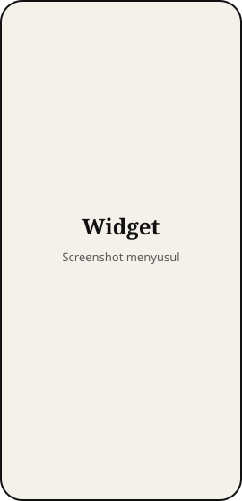
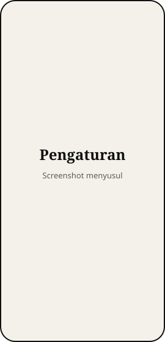

# InkWidgets

Dua widget layar utama Android bergaya e-ink, plus aplikasi pendamping untuk melihat, menambah, dan mengkustomisasi widget. Tanpa internet, tanpa iklan.

| Widget | Ukuran default | Fungsi |
|---|---|---|
| **Jam Dot-Matrix** | 4x2, bisa diubah horizontal dan vertikal | Jam 24 jam `HH:mm` dari grid titik 5x7 ditambah tanggal (mis. `SEL 3 NOV`). Ketuk untuk membuka aplikasi Jam. |
| **Search Bar** | 4x1, bisa diubah horizontal | Kapsul ramping: huruf **G** di kiri, mikrofon dan kamera di kanan. Ketuk bilah untuk Google Search, mikrofon untuk pencarian suara, kamera untuk Google Lens. |

Palet default: Ink `#111111`, Paper `#F4F1EA`, Muted `#5A5A5A`, titik mati Ink 12%, latar transparan.

- Package: `com.taro.inkwidgets`, versi 2.0
- minSdk 26, targetSdk/compileSdk 35
- Gradle 8.14.3, AGP 8.13.0, Kotlin 2.2.20, JDK 17
- UI aplikasi: Jetpack Compose + Material 3 (Compose BOM 2025.10.01), Navigation Compose
- Widget: AppWidgetProvider + RemoteViews, digambar dengan Canvas

## Aplikasi

Satu Activity dengan bottom navigation tiga tab. Semua bergaya e-ink: latar kertas, teks tinta, garis tipis, judul serif, tanpa bayangan dan animasi.

| Widget | Kustomisasi | Pengaturan |
|---|---|---|
|  |  |  |

> Gambar di atas masih placeholder. Ambil screenshot di HP, simpan sebagai `docs/screenshot-widget.png` (dan seterusnya), lalu ganti ekstensi `.svg` menjadi `.png` di tabel ini.

**1. Widget (beranda)**
- Pratinjau live tiap widget. Gambarnya dibuat oleh renderer yang sama dengan widget asli, jadi hasil kustomisasi terlihat persis.
- Jumlah widget yang sedang terpasang.
- **Tambah ke layar utama**: memakai `requestPinAppWidget`. Kalau launcher tidak mendukung (sering di MIUI), muncul lembar berisi langkah manual. Langkah manual juga bisa dibuka lewat tombol **Cara manual**.

**2. Kustomisasi**
- Pilih **Jam** atau **Search**. Pratinjau di atas langsung berubah saat opsi diubah.
- **Warna**: E-ink terang, E-ink gelap, Hitam-putih, Sepia, atau Kustom (kode hex untuk tinta, kertas, teks sekunder).
- **Ukuran**:
  - Jam: ukuran jam, ukuran titik, ukuran tanggal.
  - Search: tinggi bilah (32–64 dp), tebal garis tepi (0–4 dp), ukuran huruf G, ukuran ikon.
- **Tampilkan**:
  - Jam: tanggal, titik mati, latar kertas.
  - Search: huruf G, mikrofon, Lens, garis pemisah.
- **Terapkan** menyimpan perubahan dan langsung memperbarui semua widget yang terpasang. **Reset ke default** mengembalikan opsi widget yang sedang dipilih ke bawaan; ketuk **Terapkan** untuk menyimpannya.
- Setelan berlaku untuk semua widget sejenis. Setelan per-widget dari versi 1 otomatis dipindahkan saat aplikasi pertama kali dibuka.

**3. Pengaturan**
- **Agar widget selalu update**: penjelasan soal MIUI, tombol ke detail aplikasi (Mulai otomatis dan Penghemat baterai), serta status izin alarm tepat waktu dengan tombol ke pengaturannya kalau belum diizinkan.
- **Perbarui semua widget sekarang**.
- **Tentang**: versi aplikasi, pembuat, dan tautan GitHub.

---

## 1. Push ke GitHub

APK di-build oleh GitHub Actions (`.github/workflows/build.yml`), jadi tidak perlu Android SDK di laptop.

```bash
git add .
git commit -m "Pesan perubahan"
git push origin main
```

Kalau push ditolak karena autentikasi:

```bash
gh auth login        # pilih GitHub.com -> HTTPS -> Login with a web browser
gh auth setup-git
git push origin main
```

## 2. Mengunduh APK dari tab Actions

1. Buka https://github.com/Clarity69/widgets-app, lalu tab **Actions**.
2. Pilih run terbaru **Build APK** (otomatis jalan setiap push ke `main`; bisa juga lewat **Run workflow**).
3. Tunggu sampai centangnya hijau.
4. Di bagian **Artifacts**, klik **InkWidgets-apk**, lalu ekstrak ZIP-nya untuk mendapatkan `app-debug.apk`.

Atau dari terminal:

```bash
gh run download --repo Clarity69/widgets-app --name InkWidgets-apk --dir apk-output
```

## 3. Install di HP (Redmi 10 2022 / MIUI 14)

> **Penting saat update:** setiap build Actions ditandatangani kunci debug yang berbeda. Kalau pemasangan ditolak ("Aplikasi tidak terpasang"), **uninstall InkWidgets lama dulu**, lalu pasang lagi. Widget di layar utama perlu ditambahkan ulang.

1. Kirim `app-debug.apk` ke HP (LocalSend, Telegram, kabel USB, dan sebagainya).
2. Buka file APK dengan **File Manager**.
3. Jika diminta, ketuk **Setelan**, lalu aktifkan **Izinkan dari sumber ini** (Install dari sumber tidak dikenal).
4. Ketuk **Pasang**. Jika MIUI menampilkan pemindaian keamanan, pilih **Tetap pasang**.

Lewat adb (opsional): `adb install -r app-debug.apk`

## 4. Menambahkan widget

- Dari aplikasi: tab **Widget**, lalu ketuk **Tambah ke layar utama**.
- Manual di MIUI: tekan lama area kosong di layar utama, ketuk **Widget**, cari **InkWidgets**, lalu seret **Jam Dot-Matrix** atau **Search Bar** ke layar. Tekan lama widget untuk mengubah ukurannya.

## 5. Mulai otomatis + penghemat baterai "Tanpa batasan" (penting untuk jam)

MIUI suka menghentikan aplikasi di latar belakang sehingga alarm per menit berhenti. Lakukan sekali saja:

1. Buka InkWidgets, lalu tab **Pengaturan**, lalu **Buka detail aplikasi**.
2. Aktifkan **Mulai otomatis** (Autostart).
3. **Penghemat baterai**: pilih **Tanpa batasan**.
4. Opsional: di menu Terbaru, tekan lama kartu InkWidgets lalu ketuk ikon **gembok**.

Catatan teknis: jam memakai alarm `RTC` *exact* (izin `USE_EXACT_ALARM`) yang dijadwalkan ulang ke awal menit berikutnya. Alarm ini tidak membangunkan HP saat layar mati; begitu layar menyala, jam langsung diperbarui. Membuka aplikasi juga menjadwalkan ulang alarm.

---

## Struktur kode

```
app/src/main/java/com/taro/inkwidgets/
├── MainActivity.kt             # satu Activity: edge-to-edge + Compose
├── ui/
│   ├── InkApp.kt               # Scaffold, bottom navigation, NavHost
│   ├── MainViewModel.kt        # state (StateFlow): setelan tersimpan/draf, jumlah widget, izin
│   ├── WidgetScreen.kt         # tab Widget
│   ├── CustomizeScreen.kt      # tab Kustomisasi
│   ├── SettingsScreen.kt       # tab Pengaturan
│   ├── components/             # komponen e-ink + pratinjau widget
│   └── theme/                  # warna, tipografi, tema Material 3 e-ink
├── DotFont.kt                  # pola titik 5x7 untuk digit 0–9
├── ClockRenderer.kt            # menggambar jam + tanggal ke Bitmap
├── SearchRenderer.kt           # menggambar search bar ke Bitmap
├── ClockWidgetProvider.kt      # widget jam, alarm per menit, broadcast waktu/boot
├── SearchWidgetProvider.kt     # widget search + suara + Lens
├── LaunchTrampolineActivity.kt # activity transparan: coba intent satu per satu
├── InkTheme.kt                 # preset warna + warna kustom
├── WidgetSettings.kt           # setelan (SharedPreferences) + migrasi dari v1
└── WidgetSize.kt               # ukuran widget dp -> px
```

## Build lokal (opsional, butuh Android SDK + JDK 17)

```bash
./gradlew assembleDebug
# APK: app/build/outputs/apk/debug/app-debug.apk
```
